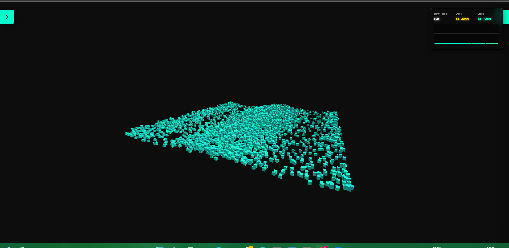
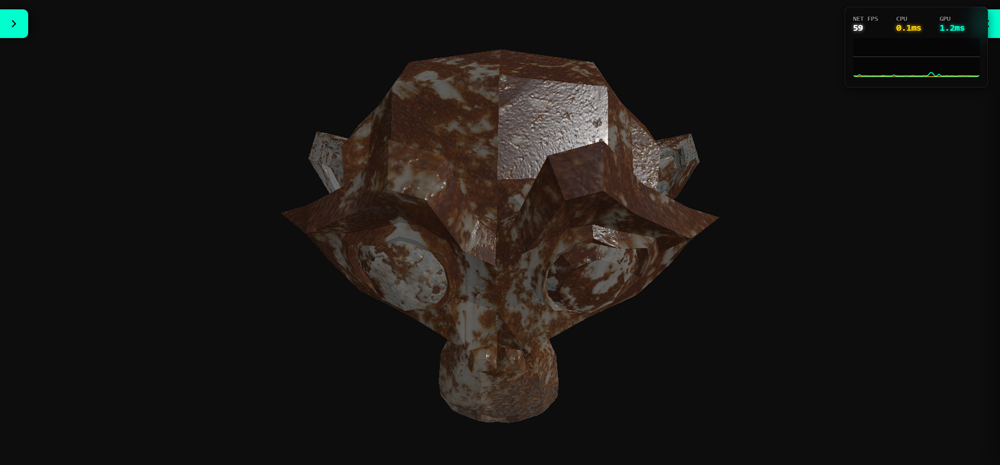
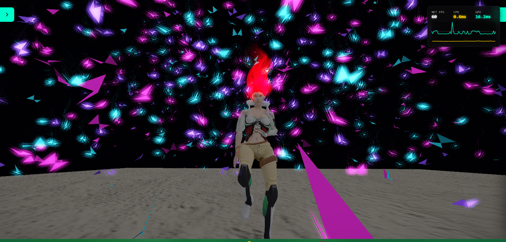

# NullGraph

A data-oriented WebGPU rendering library with explicit render and compute scheduling, flat
instance data, and optional GPU-driven rendering and simulation modules.

<div align="center">

[](https://www.npmjs.com/package/null-graph)
[](https://www.npmjs.com/package/null-graph)
[](https://bundlephobia.com/package/null-graph)
[](./LICENSE)
[](https://github.com/Vikas593-cloud/NullGraph/stargazers)

</div>

NullGraph has no retained scene graph. Applications supply geometry, buffers, batches and an
ordered sequence of compute stages and render passes. This makes resource ownership and execution
order explicit, and lets GPU simulation output feed rendering without a per-frame CPU readback.
It can run on the main thread, in a Web Worker with an `OffscreenCanvas`, or headlessly with a
WebGPU implementation.

The repository also includes offline rendering tools: fixed-step scene recording, GPU-state tracks,
checkpoints, replay, and frame export to PNG or ffmpeg video, independent of real-time frame rate.
The agent APIs provide GPU policy tables, species-specific brains, and explicit stepping for
application-defined population evaluation, co-evolution, and historical-opponent comparisons.

## Installation and getting started

```sh
npm install null-graph
```

Import the core and the modules your application needs:

```ts
import { NullGraph, Camera } from 'null-graph';
import { Primitives, StandardLayout } from 'null-graph/geometry';
import { StandardPBRMaterial } from 'null-graph/materials';
```

- [Application guide and runnable examples](https://github.com/Vikas593-cloud/NullGraph/blob/master/docs/agent/guide.md)
- [Core setup and usage](https://github.com/Vikas593-cloud/NullGraph/blob/master/docs/api/core.md)
- [Core API and buffer reference](https://github.com/Vikas593-cloud/NullGraph/blob/master/docs/api/core-reference.md)
- [Documentation index for coding assistants](https://github.com/Vikas593-cloud/NullGraph/blob/master/llms.txt)

The application guide includes complete examples and a render-to-PNG workflow. Its tooling runs
from a repository checkout; the npm package ships the library's `dist/` files, not the repository
runners. Branch-head documentation may describe changes newer than your installed package;
match documentation to the release or commit you use.

## Rendering model

- **Flat data rather than scene traversal.** Instance transforms and attributes live in typed
  arrays or GPU buffers. Applications manage hierarchy and gameplay state themselves.
- **Explicit scheduling.** Submit a linear sequence of compute stages and render passes, including
  multipass rendering, custom WGSL, and direct or indirect draws.
- **Batched geometry and instances.** Geometry pools, instance buffers and GPU visibility reduce
  per-object submission work. Draw count still depends on meshes, materials and passes.
- **GPU-resident integration.** Compute stages can write buffers that later rendering stages use.
  Buffers shared on the same device can avoid CPU readback and re-upload. Uploading a CPU typed
  array still transfers data to the GPU; it is not a zero-copy CPU-to-VRAM operation.
- **Worker and headless support.** Use `OffscreenCanvas` for worker rendering, or render to an
  offscreen texture without a canvas. An existing `GPUDevice` can be adopted for interoperability.
- **Reusable frame resources.** Buffer-backed APIs and prebuilt stage sequences support low-
  allocation frame loops. Applications remain responsible for their own allocations and uploads.

## Modules and features

Modules are separate package subpaths so applications can import only what they use. Bundle size
depends on the imported features and the application's bundler.

| Import                   | Implemented features                                                                                                                                                                | Documentation                                                                                                                                                                                                  |
|--------------------------|-------------------------------------------------------------------------------------------------------------------------------------------------------------------------------------|----------------------------------------------------------------------------------------------------------------------------------------------------------------------------------------------------------------|
| `null-graph`             | Device initialization/adoption, cameras, buffer and texture management, batches, compute stages, render passes, indirect drawing and headless rendering                             | [Usage](https://github.com/Vikas593-cloud/NullGraph/blob/master/docs/api/core.md) · [Reference](https://github.com/Vikas593-cloud/NullGraph/blob/master/docs/api/core-reference.md)                                |
| `null-graph/geometry`    | Vertex layouts, primitives, geometry builders, dynamic geometry, unified vertex/index pools, meshlets and LOD-chain construction                                                    | [Geometry](https://github.com/Vikas593-cloud/NullGraph/blob/master/docs/api/geometry.md)                                                                                                                         |
| `null-graph/materials`   | PBR, Lambert, Toon, Basic, Emissive and Matcap materials; composable WGSL shader builders                                                                                           | [Materials](https://github.com/Vikas593-cloud/NullGraph/blob/master/docs/api/materials.md)                                                                                                                       |
| `null-graph/loaders`     | GLB parsing, animation timelines, skeletal data, rigid/skinned animation baking and WGSL helpers for visible-instance animation palettes                                              | [Loaders and animation](https://github.com/Vikas593-cloud/NullGraph/blob/master/docs/api/loaders.md)                                                                                                             |
| `null-graph/visibility`  | GPU instance and meshlet culling, Hi-Z occlusion, normal-cone rejection, meshlet and instance LOD, indirect draws and app-defined instance vertex hooks                               | [Visibility](https://github.com/Vikas593-cloud/NullGraph/blob/master/docs/api/visibility.md) · [Shader reference](https://github.com/Vikas593-cloud/NullGraph/blob/master/docs/api/visibility-shader-reference.md) |
| `null-graph/lights`      | Buffer-backed lights with standard, tiled-forward and clustered-forward lighting                                                                                                    | [Lights](https://github.com/Vikas593-cloud/NullGraph/blob/master/docs/api/lights.md) · [Shader reference](https://github.com/Vikas593-cloud/NullGraph/blob/master/docs/api/lights-shader-reference.md)             |
| `null-graph/shadows`     | Cascaded directional shadows, punctual-light shadow atlas, cached tiles and caster culling integrated with visibility                                                               | [Shadows](https://github.com/Vikas593-cloud/NullGraph/blob/master/docs/api/shadows.md) · [Shader reference](https://github.com/Vikas593-cloud/NullGraph/blob/master/docs/api/shadows-shader-reference.md)          |
| `null-graph/environment` | Image-based diffuse/specular lighting, environment prefiltering, BRDF LUTs, irradiance volumes, GPU probe capture and parallax-corrected reflection probes                          | [Environment](https://github.com/Vikas593-cloud/NullGraph/blob/master/docs/api/environment.md) · [Probes](https://github.com/Vikas593-cloud/NullGraph/blob/master/docs/api/probes.md)                              |
| `null-graph/post`        | Explicit post-processing chains, reusable transient render targets, uniform arenas and effects including bloom, SSAO, depth of field, FXAA and tone mapping                         | [Post-processing](https://github.com/Vikas593-cloud/NullGraph/blob/master/docs/api/post.md) · [Presets](https://github.com/Vikas593-cloud/NullGraph/blob/master/docs/post-presets.md)                              |
| `null-graph/picking`     | On-demand GPU picking for supported batches and visibility instances, returning source instance index, depth and world position                                                     | [Picking](https://github.com/Vikas593-cloud/NullGraph/blob/master/docs/api/picking.md)                                                                                                                           |
| `null-graph/text`        | GPU-culled SDF/MSDF labels, halos, depth modes, atlas generation/loading and labels following GPU-buffer positions                                                                  | [Text](https://github.com/Vikas593-cloud/NullGraph/blob/master/docs/api/text.md)                                                                                                                                 |
| `null-graph/agents`      | GPU fixed-step sense → think → act simulation, spatial neighbour queries, WGSL rule policies, small dense-network inference, custom sensors/actions, inspection and instance output | [Agents](https://github.com/Vikas593-cloud/NullGraph/blob/master/docs/api/agents.md) · [Spatial grid](https://github.com/Vikas593-cloud/NullGraph/blob/master/docs/api/agent-grid.md)                              |
| `null-graph/inference`   | Networks trained elsewhere: reads a small dense network from an `.onnx` file for the agents' network brain, and runs other models through ONNX Runtime Web on GPU buffers           | [Inference](https://github.com/Vikas593-cloud/NullGraph/blob/master/docs/api/inference.md)                                                                                                                         |
| `null-graph/cameras`     | Orbit, fly, follow and path controllers with DOM-independent state and optional input proxies                                                                                       | [Cameras](https://github.com/Vikas593-cloud/NullGraph/blob/master/docs/api/cameras.md)                                                                                                                           |
| `null-graph/debug-ui`    | Debug views and telemetry, including grid and agent visualization                                                                                                                   | [Debug UI](https://github.com/Vikas593-cloud/NullGraph/blob/master/docs/api/debug-ui.md)                                                                                                                         |
| `null-graph/profiler`    | WebGPU timestamp-query profiling on devices that support it                                                                                                                         | [Profiler](https://github.com/Vikas593-cloud/NullGraph/blob/master/docs/api/profiler.md)                                                                                                                         |

### Lighting and environmental effects

Direct lights, shadows and indirect lighting connect to materials through shader-layout contracts.
Probe volumes support iterative bounce-light capture, while reflection probes supply local
specular lighting. These are probe-based approximations, not ray-traced or guaranteed leak-free GI.

Additional environment APIs are documented by feature rather than implementation order:

- [Physical atmosphere](https://github.com/Vikas593-cloud/NullGraph/blob/master/docs/api/atmosphere.md)
- [Aerial perspective and fog](https://github.com/Vikas593-cloud/NullGraph/blob/master/docs/api/aerial-perspective.md)
- [Time of day](https://github.com/Vikas593-cloud/NullGraph/blob/master/docs/api/time-of-day.md)
- [Night rendering](https://github.com/Vikas593-cloud/NullGraph/blob/master/docs/api/night-sky.md)
- [Environment shader and buffer layouts](https://github.com/Vikas593-cloud/NullGraph/blob/master/docs/api/environment-shader-reference.md)
- [Probe shader and buffer layouts](https://github.com/Vikas593-cloud/NullGraph/blob/master/docs/api/probes-shader-reference.md)

### GPU agents

`AgentSystem` keeps live simulation state on the GPU and exposes explicit frame and lockstep
scheduling. `RuleBrain` runs application WGSL; `MlpBrain` evaluates a supplied dense network.
Each species can run its own brain (`setBrain(brain, { species })`), so rules and networks of
different shapes can share one system, `MlpBrain.byGenome` holds a table of same-shape networks
chosen per agent by the record's `genome` word, and `prepareBrain` compiles a brain ahead so that
a switch compiles nothing. Neither policy is restricted to predator/prey or flocking behaviour.
Applications define their observations, action semantics and additional simulation stages.

The built-in movement and neighbour-query model is currently planar (XZ). The built-in network
kernel runs small dense networks; adding a network does not train it. Larger models run through
ONNX Runtime Web as an `OrtBrain`, from `null-graph/inference`: the app installs ONNX Runtime, an
optional peer dependency, and its actions arrive one frame late in interactive frames. Training
tooling is in the repository, not in the package.
Neighbour scans have a configurable per-cell budget: crowded cells can omit candidates, and
overflow-free operation is required for the documented same-device deterministic replay guarantee.
See the [agents guide](https://github.com/Vikas593-cloud/NullGraph/blob/master/docs/api/agents.md)
for supported shapes, buffer ownership, inspection and integration examples.

### Population policies and co-evolution building blocks

The agent module provides reusable execution primitives for applications that evaluate multiple
policies, evolve interacting populations, or compare current policies with historical opponents:

- **Per-agent policy selection.** `MlpBrain.byGenome` stores same-shape networks in a GPU table;
  each agent's `genome` field selects its policy row. Candidate policies and archived policies can
  share a table without creating a separate brain for every network.
- **Independent species policies.** `setBrain(brain, { species })` assigns brains per species,
  including networks of different shapes or a mixture of neural and WGSL rule policies.
- **In-place policy updates.** `setWeights` replaces a network's weights, while `setRows` uploads
  contiguous packed rows to a genome-indexed table. Shapes and activations remain fixed; policy
  updates do not require rebuilding the brain. `prepareBrain` prepares a different brain ahead
  of a later switch.
- **Explicit rollout scheduling.** Frame and lockstep execution let applications control simulation
  advancement, policy changes, and additional compute stages. GPU simulation buffers can feed
  rendering directly; inspection and evaluation readbacks remain explicit.

These primitives support application-managed co-evolution and Hall-of-Fame-style (HoF) opponent
sampling: applications retain historical networks, upload them as policy rows, and assign agents
to current or archived policies. The library does not select archive members, define fitness,
optimize weights, or guarantee that an evolved policy improves. Training algorithms, archive
management, and evaluation protocols belong to application code or separate repository tooling,
not the packaged agent runtime.

### Offline rendering and replay

The repository's film tooling separates simulation from image production. A scene advances with a
fixed timestep, declares GPU buffers to record, and supplies a rendering sequence. Record tracks
without drawing, then replay them to render another camera, resolution or playback speed without
rerunning the simulation. Export PNG frames or encode video through ffmpeg (60 fps by default).

Full-buffer checkpoints and segment-level resume preserve committed work. Packed tracks can trade
precision and sampling frequency for storage; they are not substitutes for exact continuation state.
Offline output removes the real-time frame budget, not GPU memory limits or submission-safety checks.

These are Node/Dawn tools in a repository checkout, not an npm package subpath or an automatic
recorder for arbitrary browser applications. New scenes supply a small adapter; the recording core
works with declared GPU buffers rather than requiring an agent simulation.
See the [film setup and commands](./tools/film/README.md) and
[general-purpose scene authoring guide](./tools/film/SCENE-AUTHORING.md).

## Requirements and boundaries

- **WebGPU is required.** There is no WebGL fallback. Optional GPU features are negotiated against
  the device; performance and available resource limits vary by adapter and host.
- **This is a rendering library, not a complete game engine.** It does not provide a retained
  scene hierarchy, gameplay ECS, general rigid-body physics or automatic asset-to-scene assembly.
- **Readbacks are explicit.** Picking, inspection and frame capture involve GPU-to-CPU transfers;
  GPU-resident frame paths need not perform those operations every frame.
- **Text layout is not a shaping engine.** Complex-script shaping and bidirectional layout require
  additional application tooling.
- **Scale is workload-dependent.** Geometry, passes, lights, shadows, query density, uploads and
  GPU limits all affect throughput. There is no universal entity-count or frame-time guarantee.

Planned capabilities are kept separate from the feature list in the
[engine roadmap](https://github.com/Vikas593-cloud/NullGraph/blob/master/docs/roadmap.md).

## Examples and validation

- [Interactive demos](https://nullgraph.dev/)
- [Demo source](https://github.com/Vikas593-cloud/NullGraph-Test-Engine)
- [Application examples](https://github.com/Vikas593-cloud/NullGraph/blob/master/docs/agent/guide.md)
- [Validation tools and workflow](https://github.com/Vikas593-cloud/NullGraph/blob/master/docs/agent/validation.md)

From a repository checkout:

```sh
npm install
npm run build:lib
npm run test:core
npm run test:agents
npm run test:agent-kit
```

Real-GPU harnesses run through Node/Dawn and headless Chrome:

```sh
npm run test:gpu
npm run test:gpu:browser
npm run render -- test/gpu/scenes/quick-start.mjs --out cube.png
npm run drive -- --serve . test/text-gpu/index.html --wait-for "passed|FAILED"
```

The GPU harnesses check numerical results and report uncaptured WebGPU errors. A passing run
applies to the tested host and workload, not every GPU or application. Read the validation guide
for setup, output reports and image inspection.

`npm run drive` serves or opens a WebGPU page in headless Chrome, captures console output and
screenshots, and can replay interaction steps from an actions file. The example above runs the
text GPU test page; see the validation guide for driving your own application.

### Screenshots

| GPU culling                                            | PBR materials                                            | Skeletal animation                                                           |
|--------------------------------------------------------|----------------------------------------------------------|------------------------------------------------------------------------------|
|  |  |  |

## Contributing and license

Maintainers and coding agents can start with
[Working on NullGraph](https://github.com/Vikas593-cloud/NullGraph/blob/master/docs/work/README.md).
Architecture notes are in the
[design principles](https://github.com/Vikas593-cloud/NullGraph/blob/master/docs/design-principles.md).

NullGraph is licensed under the [MIT license](./LICENSE).
