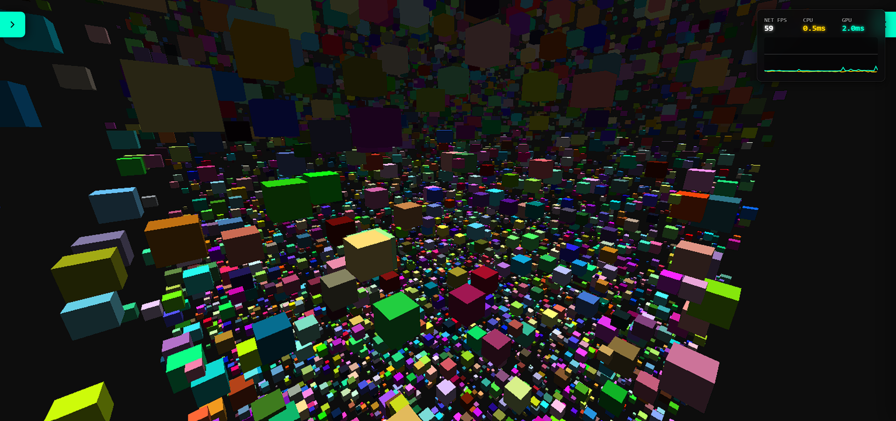
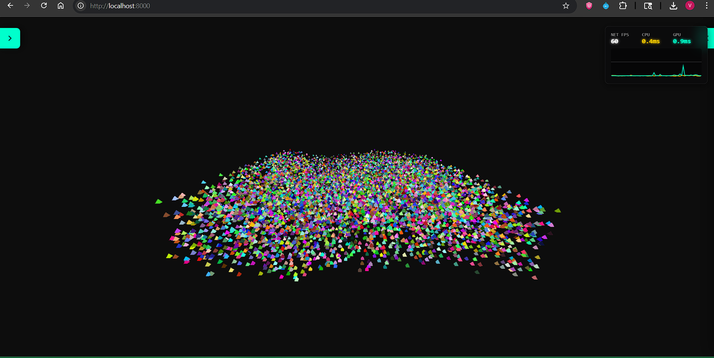
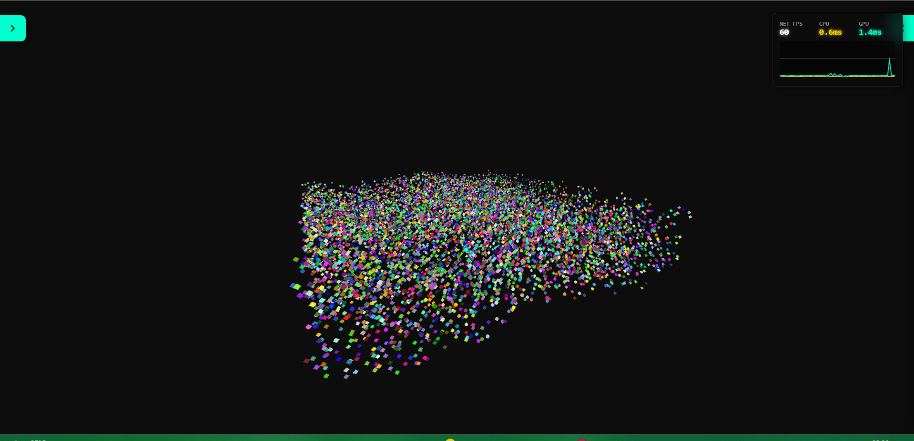
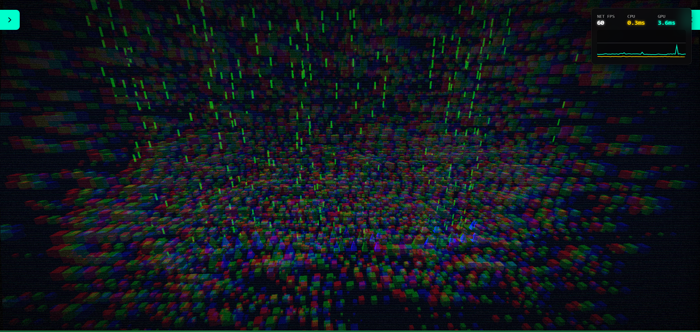
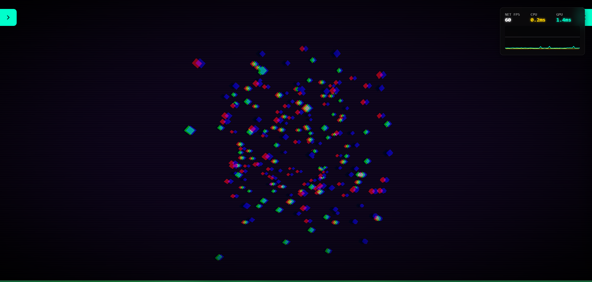
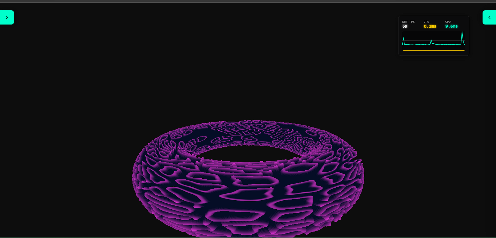

# NullGraph

> Zero scene graph. Zero copy. Infinite scale.

<div align="center">

[](https://www.npmjs.com/package/null-graph)
[](https://www.npmjs.com/package/null-graph)
[](https://bundlephobia.com/package/null-graph)
[](https://github.com/Vikas593-cloud/NullGraph-Test-Engine/blob/main/LICENSE)
[](https://github.com/Vikas593-cloud/NullGraph/stargazers)

</div>

A Data-Oriented WebGPU rendering framework for massive web worlds.

NullGraph is a brutalist, high-performance rendering library designed specifically for Web Workers and Data-Oriented Design (DOD).

It completely abandons the traditional Object-Oriented Scene Graph (`Root -> Node -> Mesh -> Geometry`) in favor of mapping raw, contiguous `ArrayBuffers` directly to WebGPU Storage Buffers.

If you are building an MMO, a voxel engine, or a multiverse with tens of thousands of dynamic entities, NullGraph keeps rendering off your main thread and out of the garbage collector.

---


# Why NullGraph?

Traditional WebGL frameworks (like Three.js or Babylon.js) are built for ease of use, heavily relying on the `new` keyword, dynamic memory, and Garbage Collection. When scaling up to massive open worlds, this OOP overhead causes main-thread stuttering and shader compilation lag.

NullGraph solves this by doing less:

- **Zero Scene Graph:** No `.traverse()`, no `.updateMatrixWorld()`. The GPU reads your flat array directly.

- **Zero-Copy Streaming:** Calculate your ECS layout in a Web Worker, pass the `Float32Array` to the main thread, and blast it straight to VRAM.

- **Render Queues (Batches):** Render thousands of unique object types simultaneously with minimal GPU state changes.

- **No GC Spikes:** Memory is pre-allocated. No runtime object creation or destruction.

- **Compute-Driven Indirect Drawing:** Offload culling entirely to the GPU. NullGraph supports WebGPU Compute Shaders that dynamically build `IndirectDrawArgs`, resulting in zero CPU overhead for visibility checks.

- **GPU-Driven Visibility (v1.0.5):** Batteries-included culling on the GPU — frustum, Hi-Z occlusion, meshlet normal-cone (backface cluster) rejection, and screen-space-error LOD. Draw-call count becomes proportional to **material count, not object count**, so 100,000 instances still cost a handful of draws.

- **Multi-Pass Architecture:** Seamlessly chain offscreen render passes into screen-space post-processing pipelines (Bloom, CRT, HUD effects) by attaching textures directly to subsequent batches.

---

# Installation and Setup

NullGraph is distributed as a modular ESM package. To maintain its "Zero-Copy" philosophy, it requires `gl-matrix` as a peer dependency to ensure your application and the engine share the same math structures.

## 1. Install via NPM

```bash
# Install the core engine
npm install null-graph

# Install required peer dependencies
npm install gl-matrix

# Recommended: Install WebGPU types for IDE autocomplete
npm install @webgpu/types --save-dev
```

---

## 2. Module Architecture

NullGraph uses Subpath Exports to keep your production bundles lean. You only pay for the features you import.

### `null-graph`
The Core Engine. Handles WebGPU device initialization, Pass management, and Buffer streaming.

### `null-graph/geometry`
The Math and Primitive Toolbox. 13 primitive generators, custom Vertex Layouts, the `MegabufferBuilder` (one unified vertex/index pool for every mesh), and the `MeshletBuilder` (cluster partitioning with bounds, normal cones, and LOD chains).

### `null-graph/visibility`
GPU-driven culling. The `VisibilitySystem` decides **on the GPU** what to draw — frustum, Hi-Z occlusion, meshlet cone culling, LOD — and issues indirect draws, so the CPU never iterates the scene.

### `null-graph/loaders`
High-performance GLBParser, Animator, and SkeletonManager for hardware-accelerated skinning.

### `null-graph/materials`
The full material family — Basic, Lambert, Toon, Emissive, Matcap, and Cook-Torrance PBR — each with its dynamic WGSL shader builder.

### `null-graph/lights`
Data-Oriented lighting. Zero-allocation light-cursor proxies plus `standard`, `tiled-forward`, and compute-driven `clustered-forward` culling for thousands of dynamic lights.

### `null-graph/post`
Screen-space post-processing. An explicit, pre-allocated `PostChain` (Bloom, SSAO, Tonemap, custom effects) with no per-frame garbage.

### `null-graph/cameras`
Decoupled orbital camera controllers — pure spherical-coordinate math plus a DOM input proxy that works on the main thread or in a Worker.

### `null-graph/debug-ui & null-graph/profiler`
Real-time performance telemetry, UI widgets, and WebGPU timestamp-query GPU profiling.

---
# The Architecture Demo Suite

## Play the Live Demo
[nullgraph.dev](https://nullgraph.dev/)

## Github Source Code [v1.0.0]
[NullGraph-Test-Engine](https://github.com/Vikas593-cloud/NullGraph-Test-Engine)

---
# Documentation

For comprehensive guides and API references, please check our documentation:

### Guides
- [Quick Start Guide](./docs/quick-start.md) — get a lit cube on screen
- [Scene Composition](./docs/scene-composition.md) — how to assemble any scene, end to end
- [Engine Roadmap](./docs/roadmap.md) — versioned module plan and what ships when
- [Post-Processing Design](./docs/post-processing-design.md) — how the `PostChain` is architected
- [Post-Processing Presets](./docs/post-presets.md) — ready-made Bloom / SSAO / Tonemap bundles
- [Transient Pool](./docs/transient-pool.md) — render-target recycling internals
- [Meshlet Geometry Design](./docs/geometry-meshlets-design.md) — clusters, bounds, cones, LOD
- [Visibility Design](./docs/visibility-design.md) — the GPU culling architecture
- [Deprecated & Breaking API Changes](./docs/deprecated-api.md) — migration guide

### API References
- [Core (`null-graph`)](./docs/api/core.md) · [Core Reference](./docs/api/core-reference.md)
- [Cameras (`null-graph/cameras`)](./docs/api/cameras.md)
- [Debug UI (`null-graph/debug-ui`)](./docs/api/debug-ui.md)
- [Geometry (`null-graph/geometry`)](./docs/api/geometry.md)
- [Lights (`null-graph/lights`)](./docs/api/lights.md) · [Shader & Compute Reference](./docs/api/lights-shader-reference.md)
- [Loaders (`null-graph/loaders`)](./docs/api/loaders.md)
- [Materials (`null-graph/materials`)](./docs/api/materials.md)
- [Post-Processing (`null-graph/post`)](./docs/api/post.md)
- [Profiler (`null-graph/profiler`)](./docs/api/profiler.md)
- [Visibility (`null-graph/visibility`)](./docs/api/visibility.md) · [Shader & Buffer Reference](./docs/api/visibility-shader-reference.md)
## Roadmap

NullGraph is the high-performance rendering backbone for the Axion Engine.

---

### Core Architecture

- [x] Multi-Object Render Queue / Batching

- [x] Depth / Z-Buffer Integration (Proper 3D occlusion)

- [x] VBO/IBO Geometry Buffer Manager

- [x] Multi-Pass Rendering & Texture Attachments

- [x] GPU Compute Frustum Culling & Indirect Drawing

- [x] Geometry Builder & `null-graph/geometry` extras

- [x] Megabuffer (unified vertex/index pool) & Meshlet Builder (bounds, cones, LOD)

- [x] GPU-Driven Visibility — two-tier culling (instance + meshlet), Hi-Z occlusion, screen-space-error LOD

- [ ] Deferred / Visibility-Buffer Shading

- [ ] Virtual Geometry (Nanite-style cluster-LOD DAG)

---

### Materials & Assets

- [x] Physically Based Rendering (Cook-Torrance BRDF)

- [x] Integrated PBR Material System (Albedo, Normal, ARM maps)

- [x] Native GLB/GLTF Parsing & Resource Unpacking

- [x] Alpha Blending & Additive Transparency States

---

### Animation & Logic

- [x] Hardware-Accelerated Skeletal Animation (GPU Skinning)

- [x] Animation Timeline & Keyframe Interpolation (Animator)

- [ ] Morph Targets / Shape Keys

- [ ] GPU-Driven Particle Systems (Compute-based)

---

### Lighting & Post-Processing

- [x] Dynamic Light System (Point / Directional / Spot) via Zero-Copy proxies

- [x] Real-time Light Culling — Tiled (Forward+) & Compute-Driven Clustered Forward

- [x] Post-Processing Pipeline (Bloom, SSAO, Tonemap, Custom Effects)

- [ ] Directional Shadows / Cascaded Shadow Maps (CSM)

- [ ] Image-Based Lighting (IBL) & Environment Mapping
---

## Showcase

<div align="center">

### Architecture Demos
|                         AoS                         |                         SoA                         |                         AoSoA                         |
|:---------------------------------------------------:|:---------------------------------------------------:|:-----------------------------------------------------:|
|  |  |  |

### GPU Compute & Post-Processing
|                        GPU Culling                         |                        Space Fleet                         | CRT Effect |
|:----------------------------------------------------------:|:----------------------------------------------------------:|:----------:|
|  |  |

### PBR Materials & Animation
|                         Rusty Metal                         |                            Skeletal Animation                             |                         Morphogenesis                         |
|:-----------------------------------------------------------:|:-------------------------------------------------------------------------:|:-------------------------------------------------------------:|
|  |  |  |

</div>

---

## 📦 Package Stats

<div align="center">

| Metric | Value |
|--------|-------|
| **Weekly Downloads** |  |
| **Version** |  |
| **License** |  |
| **Minified + GZip** |  |

</div>

---

## 🔗 Related Repositories

| Repository                                                                           | Description |
|--------------------------------------------------------------------------------------|-------------|
| [**NullGraph Test Engine**](https://github.com/Vikas593-cloud/NullGraph-Test-Engine) | Interactive demo suite & documentation hub |
| [**Axion Engine**](https://axion-engine.web.app)                                     | Full game engine built on NullGraph |

<p align="center">
  <sub>Built with 🔥 by the NullGraph</sub>
</p>